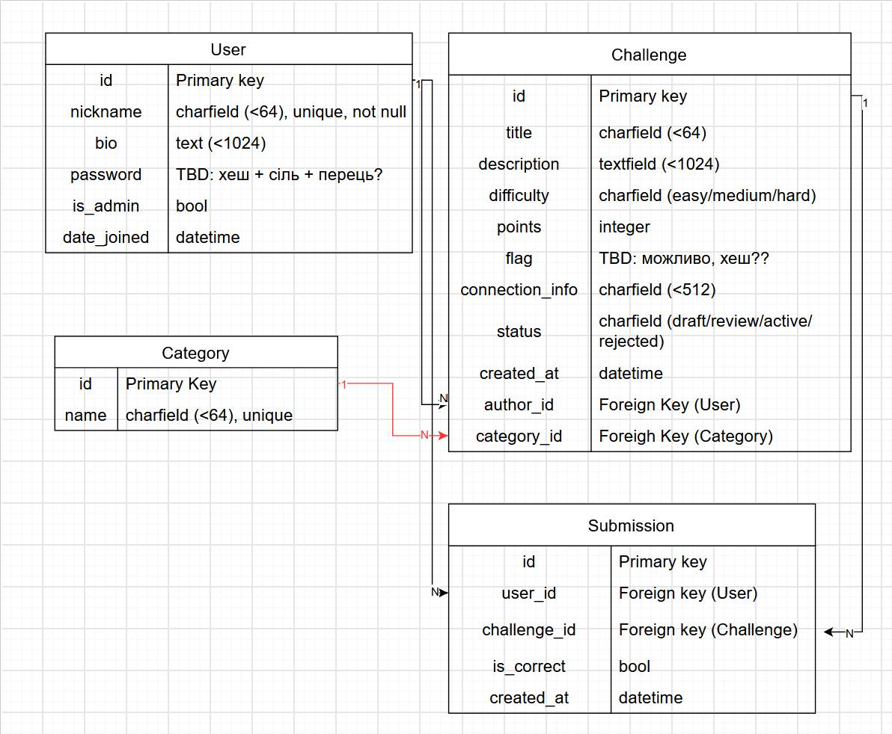

# GenericCTF

## 1.

Сайт, на якому є користувачі, список лідерів, завдання ctf, з полями пошуку завдань
ctf, з категоріями ctf, з можливістю підключати сторонні ресурси для хостингу саме
завдань. Мають бути різні рівні задач (Easy, Medium, Hard), кількість балів за
задачу, орієнтовна кількість балів (TBD: подумати, чи фіксована кількість чи
динамічна кількість балів, у залежності від кількості рішень на задачі), який отримує
користувач. Тобто, окрема сторінка задач, окрема міні-сторінка про кожну задачу,
окрема сторінка списку лідерів, окрема сторінка кожного користувача, окрема сторінка
із формою реєстрації/входу.

Головна сторінка: невеличка welcome-сторінка із описом про що вебсайт, якась
статистика, типу кількості користувачів, задач

Сторінка списку задач: обмежений список задач, який потихеньку за необхідності
підгружає задачі, відображається складність, назва, автор, кількість балів, категорія
кожної задачі, із можливістю пошуку та сортування по названих ідентифікаторах.

Сторінка лідербоарду: Лідербоард, по 3 категоріях: кількість вирішених завдань
всього, кількість вирішених завдань першим (First Blood), за кількостю балів. Перші
3 підсвічуються, є можливість перейти на сторінку індивідуального користувача.

Сторінка індивідуального користувача: відображається дата створення акаунту, балів,
вирішених завдань, кількість First-blood-ів, задачі, які розробив користувач, опис
про себе, нікнейм. Якщо профіль свій - право на редагування опису та нікнейму.

Сторінка індивідуального завдання: так само, автор, бали, складність, категорія,
кнопка "почати" (TBD: що саме робить кнопка почати), список, і
хто отримав First Blood, кнопка відправки прапорця

Модерація: адмін рев'юває задачі, відповідно, у кожної задачі додається ще тег
"чернетка" (бачить адмін, та тільки користувач, який створив), "на рев'ю"
(надісланий, бачить тільки адмін та автор, щоб задачу не розв'язали до публікації,
задача не дає бали), "доданий/активний" (TBD: подумати над цим тегом)
Відповідно, є сторінка з модерацієї для адміна і користувача, об'ємно, тому TBD:
сторінка модерації/викладення задачі

Має бути 2 рівня користувачів, адмін та користувач. Адмін може видаляти, редагувати,
додавати будь-які задачі, користувач має право видаляти, редагувати задачі зі своїм
авторством, та має право надіслати задачу на перегляд Адмін-у.

Сторінка з правилами: TBD: подумати про конкретні правила

Має бути хеадер із посиланнями на сторінки лідербоардів, задач, правил

## API

### Ресурси

- challenges
- categories
- users
- submissions
- leaderboard
- stats
- authentication

### Challenges

**`GET /api/v1/challenges/`** - список задач з фільтрами
- параметри: `search`, `category`, `difficulty` (easy/medium/hard), `author`,
  `status` (draft/review/active/rejected), `ordering` (+-points, +-solves, +-created_at)
  , `page`
- `200`:
  ```json
  {
    "count": <кількість>,
    "next": <посилання/null>,
    "previous": <посилання/null>,
    "results": [
      {
        "id": <id>,
        "title": "<назва>",
        "difficulty": "<складність>",
        "points": <бали>,
        "category": {
          "id": <id>,
          "name": "<категорія>"
        },
        "author": {
          "id": <id>,
          "nickname": "<нікнейм>"
        },
        "solves": <кількість>
      }
    ]
  }
  ```
- `400` - невалідний фільтр: `{"detail": "<помилка>"}`

**`POST /api/v1/challenges/`** - створити задачу з статусом чернетки
- body:
  ```json
  {
    "title": "<назва>",
    "description": "<опис>",
    "category": <id>,
    "difficulty": "<складність>",
    "points": <бали>,
    "flag": "<флаг>",
    "connection_info": "<адреса>"
  }
  ```
- `201`:
  ```json
  {
    "id": <id>,
    "title": "<назва>",
    "description": "<опис>",
    "category": {
      "id": <id>,
      "name": "<категорія>"
    },
    "difficulty": "<складність>",
    "points": <бали>,
    "connection_info": "<адреса>",
    "status": "draft",
    "author": {
      "id": <id>,
      "nickname": "<нікнейм>"
    },
    "created_at": "<дата>"
  }
  ```
- `400`: `{"<поле>": ["<помилка>"]}`
- `401`

**`GET /api/v1/challenges/<id>/`** - деталі задач, без флагу
- `200`:
  ```json
  {
    "id": <id>,
    "title": "<назва>",
    "description": "<опис>",
    "category": {
      "id": <id>,
      "name": "<категорія>"
    },
    "difficulty": "<складність>",
    "points": <бали>,
    "connection_info": "<адреса>",
    "status": "<статус>",
    "author": {
      "id": <id>,
      "nickname": "<нікнейм>"
    },
    "solves": <кількість>,
    "first_blood": {
      "user": {
        "id": <id>,
        "nickname": "<нікнейм>"
      },
      "solved_at": "<дата>"
    },
    "created_at": "<дата>"
  }
  ```
- `404` - задача не існує (або вона не active, а ти не автор і не адмін)

**`PATCH /api/v1/challenges/<id>/`** - редагувати задачу або змінити статус
- body: будь які поля з POST, що змінюються, та/або `status`, наприклад `{"status": "review"}`
- переходи статусу: автор - з draft на review; адмін - теж саме, тільки ще + з
  review на active/rejected
- `200` - оновлена задача (як у `GET /api/v1/challenges/<id>/`)
- `400` - невалідні поля або невалідний перехід: `{"status": ["<помика>"]}`
- `401`
- `403` - не автор і не адмін
- TBD: коментар адміна при відхиленні

**`DELETE /api/v1/challenges/<id>/`** - видалити задачу (автор або адмін)
- `204` - видалено, без body
- `401`
- `403` - не автор і не адмін

**`GET /api/v1/challenges/<id>/solves/`** - хто вирішив задачу і хто отримав First Blood
- `200`:
  ```json
  [
    {
      "user": {
        "id": <id>,
        "nickname": "<нікнейм>"
      },
      "solved_at": "<дата>",
      "first_blood": <t/f>
    }
  ]
  ```

**`POST /api/v1/challenges/<id>/submissions/`** - відправити флаг, кожна спроба
зберігається
- body: `{"flag": "<флаг>"}`
- `201` при будь-якому флагу:
  ```json
  {
    "correct": true,
    "points": <бали>,
    "first_blood": <t/f>
  }
  ```
  або `{"correct": false}`
- `400` - флаг відсутній або порожній: `{"flag": ["<помилка>"]}`
- `401`
- `409` - задачу вже вирішено цим користувачем: `{"detail": "<помилка>"}`
- TBD: обмеження кількості спроб/429 при рейтліміті (подумати скільки і на скільки)

### Categories

**`GET /api/v1/categories/`** - список категорій
- `200`:
  ```json
  [
    {
      "id": <id>,
      "name": "<категорія>"
    }
  ]
  ```
- TBD: додавати категорії через адмінку

### Users

**`GET /api/v1/users/<id>/`** - профіль користувача
- `200`:
  ```json
  {
    "id": <id>,
    "nickname": "<нікнейм>",
    "bio": "<опис>",
    "date_joined": "<дата>",
    "points": <бали>,
    "solves": <кількість>,
    "first_bloods": <кількість>
  }
  ```

**`GET /api/v1/users/<id>/challenges/`** - задачі, створені користувачем
- `200` - список задач у форматі як у `GET /api/v1/challenges/`

**`GET /api/v1/users/me/`** - свій профіль
- `200` - як у профілі користувача
- `401`

**`PATCH /api/v1/users/me/`** - редагувати свій нікнейм та/або опис
- body:
  ```json
  {
    "nickname": "<нікнейм>",
    "bio": "<опис>"
  }
  ```
  (можна передати лише одне з полів)
- `200` - оновлений профіль
- `400` - нікнейм зайнятий або порожній: `{"nickname": ["<помилка>"]}`
- `401`

### Moderation

**`GET /api/v1/challenges/?status=review`** - черга модерації (адмін)/свої задачі
на ревжю (автор)
- `200` - список задач у форматі як у `GET /api/v1/challenges/` (автор бачить тільки
  свої)
- `401`

### Leaderboard

**`GET /api/v1/leaderboard/?by=points`** - список лідерів, `by`:
points/solves/first_bloods
- `200`:
  ```json
  [
    {
      "rank": <місце>,
      "user": {
        "id": <id>,
        "nickname": "<нікнейм>"
      },
      "points": <бали>,
      "solves": <кількість>,
      "first_bloods": <кількість>
    }
  ]
  ```
- `400` - невалідне значення: `{"detail": "<помилка>"}`

### Stats

**`GET /api/v1/stats/`** - стата для головної сторінки
- `200`:
  ```json
  {
    "users": <кількість>,
    "challenges": <кількість>,
    "solves": <кількість>
  }
  ```

### Auth

- TBD: реєстрація та вхід - вроді пізніше більш детально розкажете про це

## Схема бази даних



- First Blood - найраніший правильний Submission для задачі
- t/f - true/false (duh)
