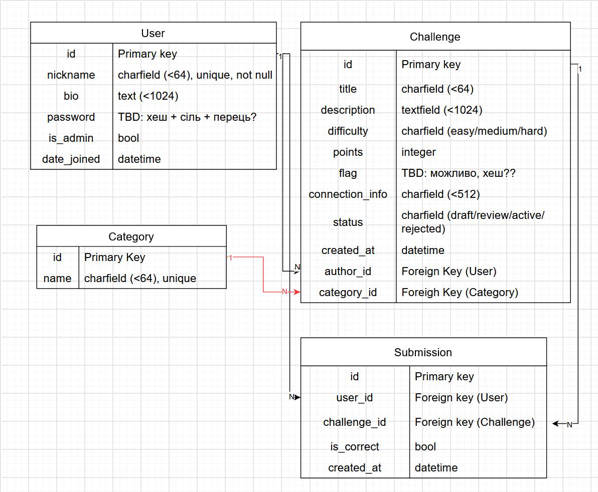

# GenericCTF

## 1.

Сайт, на якому є користувачі, список лідерів, завдання ctf, з полями пошуку завдань
ctf, з категоріями ctf, з можливістю підключати сторонні ресурси для хостингу саме
завдань. Мають бути різні рівні задач (Easy, Medium, Hard), кількість балів за
задачу, орієнтовна кількість балів (TBD: подумати, чи фіксована кількість чи
динамічна кількість балів, у залежності від кількості рішень на задачі), який отримує
користувач. Тобто, окрема сторінка задач, окрема міні-сторінка про кожну задачу,
окрема сторінка списку лідерів, окрема сторінка кожного користувача, окрема сторінка
із формою реєстрації/входу.

Головна сторінка: невеличка welcome-сторінка із описом про що вебсайт, якась
статистика, типу кількості користувачів, задач

Сторінка списку задач: обмежений список задач, який потихеньку за необхідності
підгружає задачі, відображається складність, назва, автор, кількість балів, категорія
кожної задачі, із можливістю пошуку та сортування по названих ідентифікаторах.

Сторінка лідербоарду: Лідербоард, по 3 категоріях: кількість вирішених завдань
всього, кількість вирішених завдань першим (First Blood), за кількостю балів. Перші
3 підсвічуються, є можливість перейти на сторінку індивідуального користувача.

Сторінка індивідуального користувача: відображається дата створення акаунту, балів,
вирішених завдань, кількість First-blood-ів, задачі, які розробив користувач, опис
про себе, нікнейм. Якщо профіль свій - право на редагування опису та нікнейму.

Сторінка індивідуального завдання: так само, автор, бали, складність, категорія,
кнопка "почати" (TBD: що саме робить кнопка почати), список, і
хто отримав First Blood, кнопка відправки прапорця

Модерація: адмін рев'юває задачі, відповідно, у кожної задачі додається ще тег
"чернетка" (бачить адмін, та тільки користувач, який створив), "на рев'ю"
(надісланий, бачить тільки адмін та автор, щоб задачу не розв'язали до публікації,
задача не дає бали), "доданий/активний" (TBD: подумати над цим тегом)
Відповідно, є сторінка з модерацієї для адміна і користувача, об'ємно, тому TBD:
сторінка модерації/викладення задачі

Має бути 2 рівня користувачів, адмін та користувач. Адмін може видаляти, редагувати,
додавати будь-які задачі, користувач має право видаляти, редагувати задачі зі своїм
авторством, та має право надіслати задачу на перегляд Адмін-у.

Сторінка з правилами: TBD: подумати про конкретні правила

Має бути хеадер із посиланнями на сторінки лідербоардів, задач, правил

## Як запустити проєкт

```
git clone https://github.com/hyperGG32/thinking.git
cd thinking
python -m venv .venv
.venv\Scripts\activate
pip install -r requirements.txt
```

Згенеруйте ключ:

```
python -c "import secrets; print(secrets.token_urlsafe(50))"
```

Створіть файл `.env` у корені проєкту і вставте в нього ключ:

```
SECRET_KEY={ВАШ_КЛЮЧ}
DEBUG=True
```

```
python manage.py migrate
python manage.py createsuperuser
python manage.py runserver 8001
```

`createsuperuser` - адмін, потрібен для категорій і модерації.

## API

### Ресурси

- challenges
- categories
- users
- submissions
- leaderboard
- stats
- auth

### Формат помилок

Усі помилки (400, 401, 403, 404, 405, 409) мають однаковий формат.

- невалідні дані (`400`), у `fields` помилки кожного поля:
  ```json
  {
    "error": "<повідомлення>",
    "fields": {
      "<поле>": ["<помилка>"]
    }
  }
  ```
- решта помилок:
  ```json
  {
    "error": "<повідомлення>",
    "fields": null
  }
  ```
- `401` - токена немає, він недійсний або прострочений
- `403` - токен є, але прав недостатньо

### Auth

JWT (`djangorestframework-simplejwt`)

- хедер для захищених запитів: `Authorization: Bearer <access>`
- access живе 5 хв, refresh - 1 день
- access прострочився (`401`) - `POST /api/v1/auth/token/refresh/`, новий access, 
  повторити запит; refresh теж `401` - логін заново
- logout - клієнт видаляє обидва токени, ендпоінта немає
- ролі:
  - анонім (неавторизований) - лише читання
  - користувач - створює задачі, редагує й видаляє свої, надсилає їх на review
  - адміністратор - все вище, плюс категорії та модерація
- видимість задач: анонім - active; користувач - active і свої; адмін - усі
- пароль: мінімум 8 символів, не поширений, не лише цифри, не схожий на username/email
  (`AUTH_PASSWORD_VALIDATORS`); у БД лише хеш

**`POST /api/v1/auth/register/`** - реєстрація
- body:
  ```json
  {
    "username": "<нікнейм>",
    "first_name": "<ім'я>",
    "last_name": "<прізвище>",
    "email": "<пошта>",
    "password": "<пароль>",
    "password_conf": "<пароль>"
  }
  ```
  (`first_name`, `last_name` - необов'язкові; `username`, імена - до 150 символів, `email` -
  до 254, паролі - до 128)
- `201`:
  ```json
  {
    "id": <id>,
    "username": "<нікнейм>",
    "first_name": "<ім'я>",
    "last_name": "<прізвище>",
    "email": "<пошта>"
  }
  ```
- `400` - порожні/задовгі поля, невалідний email, username чи email вже зайняті (без
  урахування регістру), паролі не збігаються, слабкий пароль

**`POST /api/v1/auth/token/`** - логін
- body: `{"username": "<нікнейм>", "password": "<пароль>"}`
- `200`: `{"access": "<токен>", "refresh": "<токен>"}`
- `400` - порожні поля
- `401` - неправильний username або пароль

**`POST /api/v1/auth/token/refresh/`** - новий access
- body: `{"refresh": "<токен>"}`
- `200`: `{"access": "<токен>"}`
- `401` - refresh недійсний або прострочений

**`GET /api/v1/auth/me/`** - поточний користувач
- хедер: `Authorization: Bearer <access>`
- `200`:
  ```json
  {
    "id": <id>,
    "username": "<нікнейм>",
    "first_name": "<ім'я>",
    "last_name": "<прізвище>",
    "email": "<пошта>",
    "is_staff": <true/false>
  }
  ```
- `401`

### Challenges

**`GET /api/v1/challenges/`** - список задач з фільтрами
- параметри: `search`, `category`, `difficulty` (easy/medium/hard), `author`,
  `status` (draft/review/active/rejected), `ordering` (+-points, +-solves, +-created_at)
  , `page`
- `200`:
  ```json
  {
    "count": <кількість>,
    "next": <посилання/null>,
    "previous": <посилання/null>,
    "results": [
      {
        "id": <id>,
        "title": "<назва>",
        "difficulty": "<складність>",
        "points": <бали>,
        "category": {
          "id": <id>,
          "name": "<категорія>"
        },
        "author": {
          "id": <id>,
          "nickname": "<нікнейм>"
        },
        "solves": <кількість>
      }
    ]
  }
  ```
- `400` - невалідний фільтр, у `fields` назва параметра
- поки немає Submission, `solves` завжди `0`, а `ordering=±solves` сортує як `-created_at`
- `status` фільтрує лише в межах видимих задач

**`POST /api/v1/challenges/`** - створити задачу з статусом чернетки
- хедер: `Authorization: Bearer <access>`, `author` - поточний користувач
- body:
  ```json
  {
    "title": "<назва>",
    "description": "<опис>",
    "category": <id>,
    "difficulty": "<складність>",
    "points": <бали>,
    "flag": "<флаг>",
    "connection_info": "<адреса>"
  }
  ```
- `201` - створена задача у форматі як у `GET /api/v1/challenges/<id>/`, `status` завжди
  `draft`, навіть якщо його передали в body
- `400` - невалідні поля
- `401` - без токена

**`GET /api/v1/challenges/<id>/`** - деталі задач, без флагу
- `200`:
  ```json
  {
    "id": <id>,
    "title": "<назва>",
    "description": "<опис>",
    "category": {
      "id": <id>,
      "name": "<категорія>"
    },
    "difficulty": "<складність>",
    "points": <бали>,
    "connection_info": "<адреса>",
    "status": "<статус>",
    "author": {
      "id": <id>,
      "nickname": "<нікнейм>"
    },
    "solves": <кількість>,
    "first_blood": {
      "user": {
        "id": <id>,
        "nickname": "<нікнейм>"
      },
      "solved_at": "<дата>"
    },
    "created_at": "<дата>"
  }
  ```
- `404` - задача не існує або вона не active, а ти не автор і не адмін
- TBD: поки немає Submission, `solves` завжди `0`, а `first_blood` завжди `null`

**`PATCH /api/v1/challenges/<id>/`** - редагувати задачу або змінити статус
- хедер: `Authorization: Bearer <access>`
- body: будь які поля з POST, що змінюються, та/або `status`, наприклад `{"status": "review"}`
- переходи статусу: автор - з draft на review; адмін - теж саме, тільки ще + з
  review на active/rejected; відхилену задачу можна знову надіслати з rejected на review
- `200` - оновлена задача (як у `GET /api/v1/challenges/<id>/`)
- `400` - невалідні поля або неіснуючий статус
- `409` - статус існує, але перехід з поточного статусу недозволений, наприклад
  draft на active. Запит коректний, заважає поточний стан задачі, тому 409, а не 400
- `401` - без токена
- `403` - не автор і не адмін; або не адмін ставить active/rejected
- TBD: коментар адміна при відхиленні

**`DELETE /api/v1/challenges/<id>/`** - видалити задачу (автор або адмін)
- хедер: `Authorization: Bearer <access>`
- `204` - видалено, без body
- `401` - без токена
- `403` - не автор і не адмін
- `404` - задача не існує

**`GET /api/v1/challenges/<id>/solves/`** - хто вирішив задачу і хто отримав First Blood
- TBD: ще не реалізовано, з'явиться разом із Submission
- `200`:
  ```json
  [
    {
      "user": {
        "id": <id>,
        "nickname": "<нікнейм>"
      },
      "solved_at": "<дата>",
      "first_blood": <t/f>
    }
  ]
  ```

**`POST /api/v1/challenges/<id>/submissions/`** - відправити флаг, кожна спроба
зберігається
- TBD: ще не реалізовано, з'явиться разом із Submission
- body: `{"flag": "<флаг>"}`
- `201` при будь-якому флагу:
  ```json
  {
    "correct": true,
    "points": <бали>,
    "first_blood": <t/f>
  }
  ```
  або `{"correct": false}`
- `400` - флаг відсутній або порожній
- `401`
- `409` - задачу вже вирішено цим користувачем
- TBD: обмеження кількості спроб/429 при рейтліміті (подумати скільки і на скільки)

### Categories

**`GET /api/v1/categories/`** - список категорій, без пагінації
- `200`:
  ```json
  [
    {
      "id": <id>,
      "name": "<категорія>"
    }
  ]
  ```

**`POST /api/v1/categories/`** - створити категорію
- хедер: `Authorization: Bearer <access>`, лише адмін
- body: `{"name": "<категорія>"}`
- `201`:
  ```json
  {
    "id": <id>,
    "name": "<категорія>"
  }
  ```
- `400` - назва порожня або вже існує
- `401` - без токена
- `403` - не адмін

**`GET /api/v1/categories/<id>/`** - одна категорія
- `200` - як у `POST /api/v1/categories/`
- `404` - категорія не існує

**`PATCH /api/v1/categories/<id>/`** - перейменувати категорію
- хедер: `Authorization: Bearer <access>`, лише адмін
- body: `{"name": "<категорія>"}`
- `200` - оновлена категорія
- `400` - назва порожня або вже існує
- `401` - без токена
- `403` - не адмін
- `404` - категорія не існує

**`DELETE /api/v1/categories/<id>/`** - видалити категорію
- хедер: `Authorization: Bearer <access>`, лише адмін
- `204` - видалено, без body
- `401` - без токена
- `403` - не адмін
- `404` - категорія не існує
- `409` - у категорії є задачі. Спершу треба видалити задачі або перенести їх в іншу
  категорію. Запит коректний, заважає поточний стан даних, тому 409, а не 400

### Users

TBD: ендпоінти користувачів

**`GET /api/v1/users/<id>/`** - профіль користувача
- `200`:
  ```json
  {
    "id": <id>,
    "nickname": "<нікнейм>",
    "bio": "<опис>",
    "date_joined": "<дата>",
    "points": <бали>,
    "solves": <кількість>,
    "first_bloods": <кількість>
  }
  ```

**`GET /api/v1/users/<id>/challenges/`** - задачі, створені користувачем
- `200` - список задач у форматі як у `GET /api/v1/challenges/`

**`PATCH /api/v1/users/me/`** - редагувати свій нікнейм та/або опис
- body:
  ```json
  {
    "nickname": "<нікнейм>",
    "bio": "<опис>"
  }
  ```
  (можна передати лише одне з полів)
- `200` - оновлений профіль
- `400` - нікнейм зайнятий або порожній
- `401`

### Moderation

**`GET /api/v1/challenges/?status=review`** - черга модерації (адмін)/свої задачі
на review (автор)
- хедер: `Authorization: Bearer <access>`
- `200` - список задач у форматі як у `GET /api/v1/challenges/` (автор бачить тільки
  свої, анонім - порожній список)

### Leaderboard

**`GET /api/v1/leaderboard/?by=points`** - список лідерів, `by`:
points/solves/first_bloods
- TBD: ще не реалізовано, з'явиться разом із Submission
- `200`:
  ```json
  [
    {
      "rank": <місце>,
      "user": {
        "id": <id>,
        "nickname": "<нікнейм>"
      },
      "points": <бали>,
      "solves": <кількість>,
      "first_bloods": <кількість>
    }
  ]
  ```
- `400` - невалідне значення `by`

### Stats

**`GET /api/v1/stats/`** - стата для головної сторінки
- TBD: ще не реалізовано, з'явиться разом із Submission
- `200`:
  ```json
  {
    "users": <кількість>,
    "challenges": <кількість>,
    "solves": <кількість>
  }
  ```

## Схема бази даних



- First Blood - найраніший правильний Submission для задачі
- t/f - true/false (duh)

## Postman

Колекція: `postman/GenericCTF.postman_collection.json`
Для колекції потрібний суперюзер, якого ви реєстрували. Перед тим, як ранити колекцію, 
оновіть змінні admin_username та admin_password відповідно до тих, які ви вказували при 
реєстрації суперюзера

## Фронтенд

[тута](https://github.com/hyperGG32/thinkingFront)
